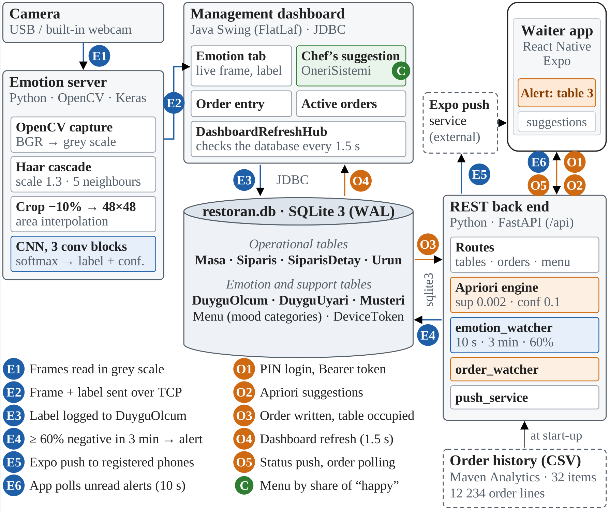

# ARS – Intelligent Restaurant System

Code and evaluation material for the article

> B. Salman, Z. Söylemez, A. B. Köse, T. Aydoğan. *An integrated restaurant management prototype
> combining facial expression recognition with association-rule menu suggestions.* Submitted to
> Balıkesir Üniversitesi Fen Bilimleri Enstitüsü Dergisi, 2026.

ARS is an undergraduate thesis prototype (Isparta University of Applied Sciences, Department of
Computer Engineering) that adds two functions to an ordinary order-management workflow: a camera-based
facial expression classifier whose labels are stored per table and turned into alerts on the
waiters' phones, and an Apriori-based recommender that suggests add-on items while an order is
entered.



## Repository contents

| Path | What it is |
|---|---|
| `evaluation/fer_protocols.py` | Expression CNN under Protocol A (image-level split, as in the thesis) and Protocol B (subject-independent 5-fold CV) |
| `evaluation/overlap_protocolA.py` | Subject / sequence / source-frame overlap between training and validation in Protocol A |
| `evaluation/apriori_eval.py`, `apriori_lib.py` | Apriori rule statistics and the temporal hold-out (HR@1/3/5 vs. popularity and random) |
| `evaluation/apriori_stats.py` | Bootstrap confidence intervals and exact McNemar test for the hold-out (same baskets) |
| `evaluation/ckplus_file_list.py` | Builds and checks the CK+ file list from your licensed local copy |
| `evaluation/make_folds_csv.py` | Writes the Protocol B fold assignment (locally) |
| `evaluation/plot_confusion.py` | Confusion-matrix figures |
| `evaluation/results/` | JSON results reported in the article |
| `training/thesis_training_colab.ipynb` | Original training notebook of the thesis (with outputs) |
| `data/` | Restaurant order data (included) and instructions for CK+ (not included) |
| `system/` | Prototype source code (desktop dashboard, emotion server, back end, waiter app) |

## Notes on the protocols

- Determinism: files are read in sorted order (class folders, then file names); fold splits depend on
  this order, on the seeds and on the pinned scikit-learn version in `requirements.txt`.

- Protocol B: StratifiedGroupKFold (5 folds, shuffled, seed 123) over subjects; inside each training part
  15% of the subjects (GroupShuffleSplit, seed 123 + fold index) form the validation group. Oversampling
  targets the largest class of the training part. Early stopping and checkpoint selection act only after
  epoch 20 (fixed rule, applied to all folds; see the article). ± values are sample standard deviations.
- Thesis run (Protocol A): the notebook's augmentation saves copies under random names in 0-9 999, so
  some copies overwrite each other; about 4 125 images remain instead of 4 200, hence 825 validation images.
  The re-implementation in `fer_protocols.py` loses no copies (840 validation images).

## Reproducing the results

```bash
python -m venv .venv && source .venv/bin/activate
pip install -r requirements.txt

# Recommendation results (Section 4.2, Tables 7-8) - runs in seconds, data included
python evaluation/apriori_eval.py --data data/maven_restaurant_orders --out evaluation/results
python evaluation/apriori_stats.py --data data/maven_restaurant_orders --out evaluation/results

# Everything below needs your licensed CK+ copy in data/ckplus48 (see data/README.md)
python evaluation/ckplus_file_list.py --data data/ckplus48 --out data/ckplus48_file_list.csv
python evaluation/overlap_protocolA.py --files data/ckplus48_file_list.csv   # Protocol A overlap (Section 4.1)
python evaluation/make_folds_csv.py --files data/ckplus48_file_list.csv     # Protocol B folds
python evaluation/fer_protocols.py --data data/ckplus48 --protocol B   # about 1 h on a CPU
python evaluation/fer_protocols.py --data data/ckplus48 --protocol A
python evaluation/fer_protocols.py --data data/ckplus48 --protocol A --warmup 20 --tag warmup20   # warm-up check
python evaluation/plot_confusion.py --results evaluation/results --out docs/figures
```

Expected output (article values):

| Result | Value |
|---|---|
| Protocol A, thesis run (validation, 825 images) | 98.9% accuracy |
| Protocol A, replication | 98.3% accuracy, macro F1 0.98 (also with the 20-epoch warm-up) |
| Protocol B, 5 subject-independent folds | 85.9 ± 4.2% accuracy, macro F1 0.79 ± 0.06 |
| Protocol A overlap (20 splits) | same subject 100%, same sequence > 99%, same source frame 94.6% |
| Apriori, all 5 343 orders | 591 frequent itemsets, 542 rules |
| Hold-out HR@1 / 3 / 5 (1 099 March baskets) | rules 3.7 / 13.2 / 22.7%, popularity 4.8 / 15.2 / 26.0%, random 3.3 / 10.0 / 16.7% |
| Rules vs. popularity, exact McNemar | HR@1 p = 0.20, HR@3 p = 0.09, HR@5 p = 0.015 |

The apriori and overlap scripts reproduce these numbers exactly. CNN results can differ slightly
between machines and TensorFlow versions (GPU non-determinism, oneDNN); the article values were
obtained with TensorFlow 2.21 on a CPU-only Linux machine.

## Data and ethics

- CK+ images are not redistributed with this repository. Researchers must obtain access from the
  dataset maintainers (https://ckplus.jeffcohn.net/) and comply with the CK+ user agreement. The
  repository provides code and instructions for preparing the dataset locally and reproducing the
  experiments. File lists, fold assignments and trained models derived from CK+ are not shared.
- The order data come from a fictitious restaurant (Maven Analytics, GPL-3.0).
- The prototype processes camera frames in memory and stores only labels, confidences and
  timestamps. Any real deployment would need notice, a lawful basis and consent under the Turkish
  Personal Data Protection Law No. 6698, and the security settings described in the article.

## Licence

Source code: MIT (see `LICENSE`). Data folders keep their own licences (see `data/`).
